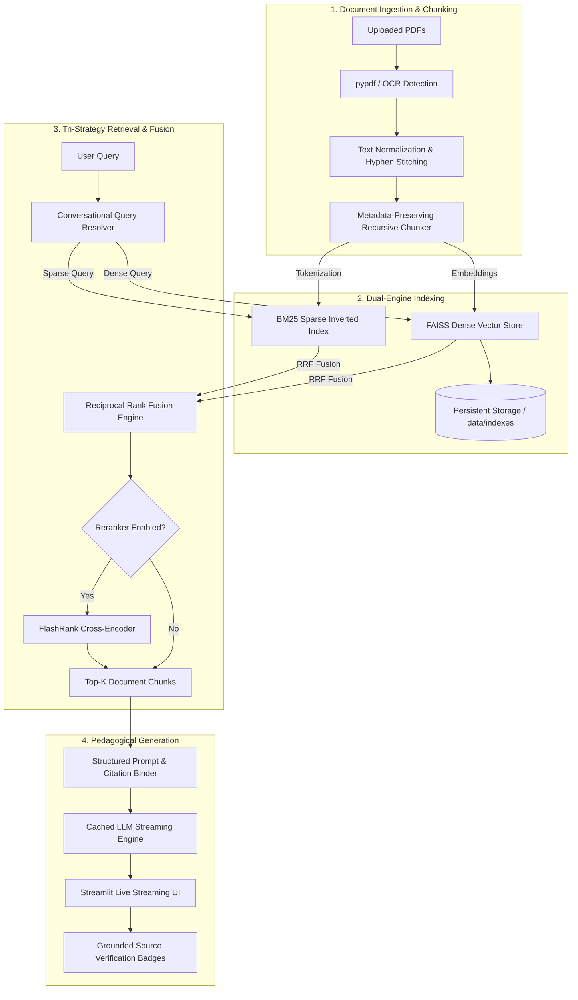

# NoteBot — Advanced Conversational RAG Application

[](https://www.python.org/downloads/)
[](https://streamlit.io/)
[](https://www.langchain.com/)
[](https://github.com/facebookresearch/faiss)
[](https://pytest.org/)
[](https://opensource.org/licenses/MIT)

**NoteBot** is a production-grade, modular Retrieval-Augmented Generation (RAG) platform and conversational academic intelligence assistant. Engineered for university students, researchers, and technical professionals, NoteBot transforms complex textbooks, technical papers, and course notes into an interactive, pedagogical tutoring session with verified citations and zero hallucination.

---

## 🌟 Key Capabilities & Architectural Highlights

- 📚 **Multi-PDF Document Ingestion**: Ingests multiple PDF documents concurrently, preserving page numbers, document names, and chunk metadata across the entire corpus.
- 🧠 **Decoupled Embedding Architecture**: Allows independent configuration of embedding models (Google Gemini `text-embedding-004`, OpenAI `text-embedding-3-small`, or **100% Free Offline FastEmbed**) from your inference LLM.
- ⚡ **Multi-Provider LLM Orchestration**: Native support for **Google Gemini**, **OpenAI**, **Groq**, and **OpenRouter** with strict key isolation and automatic multi-model fallback hierarchies.
- 🔍 **Tri-Mode Retrieval System**:
  - **Dense Vector Similarity**: Fast, high-recall vector search using FAISS.
  - **Maximum Marginal Relevance (MMR)**: Penalizes information redundancy to maximize candidate diversity.
  - **Hybrid Search (BM25 + FAISS)**: Merges sparse lexical keyword search with dense semantic embeddings via **Reciprocal Rank Fusion (RRF)**.
- 🎯 **Neural Cross-Encoder Reranking**: Optional high-precision neural reranking powered by **FlashRank** to score retrieved passages with full cross-attention.
- 💾 **Persistent Vector Index Storage**: Automatically serializes FAISS indexes and metadata to disk using content hashing. Reloads previously indexed document sets in **0ms** without re-embedding.
- 💬 **Contextual Conversational Memory**: Resolves pronouns and ambiguous follow-up queries using conversational anchor heuristics and contextual rewriting.
- 🛡️ **Grounded Citations & Zero Hallucination**: Instructs the model to synthesize explanations rather than copying raw text, binding facts to `[Doc: <file>, Page: <page>]` citation badges with verification checks.
- 🧪 **Enterprise Test Suite**: 22 unit and integration tests executing in under 4 seconds with 100% offline mocked fixtures (zero API cost).

---

## 🏗️ System Architecture & Data Flow



---

## 📁 Repository Structure

```
NoteBot---RAG-APPLICATION/
│
├── app.py                          # Streamlit UI & Orchestration Entrypoint
│
├── notebot/                        # Modular Core Package
│   ├── __init__.py
│   ├── config/
│   │   ├── settings.py             # Type-safe AppConfig & provider-key mappings
│   │   └── logging_config.py       # Thread-safe logging with credential redaction
│   ├── ingestion/
│   │   ├── pdf_loader.py           # Multi-PDF parser & corruption handler
│   │   ├── ocr_processor.py        # Scanned page detector & OCR engine
│   │   └── text_cleaner.py         # Hyphenation stitcher & whitespace normalizer
│   ├── chunking/
│   │   └── chunker.py              # Recursive text splitting with metadata preservation
│   ├── embeddings/
│   │   └── embedding_manager.py    # Independent factory (Gemini, OpenAI, FastEmbed)
│   ├── vectorstore/
│   │   ├── faiss_manager.py        # FAISS manager (similarity, MMR, scores)
│   │   └── persistence.py          # Disk serialization, dataset hashing & safe loader
│   ├── retrieval/
│   │   ├── retriever.py            # Unified retriever orchestrator
│   │   ├── hybrid_search.py        # BM25 + FAISS Reciprocal Rank Fusion
│   │   ├── reranker.py             # FlashRank cross-encoder reranker
│   │   └── query_rewriter.py       # Conversational follow-up query rewriting
│   ├── llm/
│   │   ├── provider_manager.py     # Key validation, fallback chains & error classifier
│   │   └── response_generator.py   # Grounded pedagogical prompt & token streaming
│   ├── conversation/
│   │   └── chat_history.py         # Session-isolated conversational memory
│   └── utils/
│       └── validators.py           # File size, magic-byte & query sanitization
│
├── tests/                          # 100% Mocked Pytest Suite (Zero API Cost)
│   ├── conftest.py                 # Mock embeddings & sample multi-doc fixtures
│   ├── test_ingestion.py           # Extraction, cleaning, and corruption tests
│   ├── test_chunking.py            # Metadata preservation and deduplication tests
│   ├── test_retrieval.py           # FAISS, MMR, BM25, RRF, and Retriever tests
│   ├── test_query_rewriter.py      # Follow-up detection and rewriting tests
│   ├── test_llm_providers.py       # Key mapping, validation and error mapping tests
│   └── test_persistence.py         # Index persistence lifecycle & hashing tests
│
├── .env.example                    # Template environment variables
├── .gitignore                      # Security-hardened git ignore
├── requirements.txt                # Pinned dependencies
└── README.md                       # Documentation
```

---

## 🚀 Quick Start Guide

### 1. Clone the Repository
```bash
git clone https://github.com/karthikN913/NoteBot---RAG-APPLICATION.git
cd NoteBot---RAG-APPLICATION
```

### 2. Install Dependencies
```bash
pip install -r requirements.txt
```

### 3. Configure Your Environment
Create your local `.env` file by copying `.env.example`:
```bash
cp .env.example .env
```
Edit `.env` with your API key(s):
```ini
# Google Gemini (Recommended - Free Tier at https://aistudio.google.com/app/apikey)
GEMINI_API_KEY="AIzaSy..."

# OpenAI (Optional - https://platform.openai.com/api-keys)
OPENAI_API_KEY="sk-proj-..."

# Groq (Optional - High-speed inference at https://console.groq.com)
GROQ_API_KEY="gsk_..."

# OpenRouter (Optional - https://openrouter.ai/keys)
OPENROUTER_API_KEY="sk-or-..."
```
*(Alternatively, enter your API key directly in the secure Streamlit sidebar).*

### 4. Run the Application
```bash
streamlit run app.py
```
Open your browser at `http://localhost:8501`.

---

## 🧪 Running Automated Tests

NoteBot includes an automated test suite designed with zero-cost mocked embeddings and fixtures:

```bash
python -m pytest tests/ -v
```

All 22 unit tests run offline in ~3.9 seconds, validating:
- Ingestion, text cleaning, hyphenation normalization, and corrupted PDF handling.
- Metadata preservation across chunk splits.
- Provider-specific API key mapping and validation.
- FAISS vector indexing, MMR search, BM25 sparse search, and Reciprocal Rank Fusion.
- Disk persistence lifecycle (save, hash, reload, delete).
- Conversational follow-up query rewriting.

---

## ⚙️ Retrieval Strategies Compared

| Strategy | When to Use | Mechanism | Speed |
| :--- | :--- | :--- | :--- |
| **Similarity Search** | Direct factual questions | L2 / Cosine distance in dense embedding space | **< 5ms** |
| **MMR (Max Marginal Relevance)** | Summaries & broad overviews | Optimizes relevance while penalizing similarity to already selected chunks | **< 15ms** |
| **Hybrid Search (BM25 + FAISS)** | Technical terms, formulas, or names | Combines lexical keyword precision with semantic understanding via RRF | **< 20ms** |
| **FlashRank Reranker** | Dense documents requiring high precision | Cross-Encoder neural scoring over top candidate chunks | **< 80ms** |

---

## 🔒 Security & Data Privacy

- **No Hardcoded Secrets**: All keys are retrieved via dedicated environment variables or session inputs. Keys are never logged.
- **Credential Redaction**: A custom `RedactingFormatter` automatically scrubs API key patterns from log outputs.
- **Git Protection**: The `.gitignore` prevents committing `.env`, `.streamlit/secrets.toml`, uploaded PDFs, or persistent index directories.
- **Safe Persistence**: Index loading enforces directory boundary checks and verifies dataset hashes to prevent loading incompatible or corrupted files.

---

## 📜 License

This project is licensed under the MIT License — see the LICENSE file for details.
